<div align="center">


# UntuShot

### Make your screenshots speak.

**Capture a moment. Explain the detail. Keep every layer.**

A native screenshot editor for Linux and Wayland, built with Rust, GTK 3 and Cairo.

**Linux / Wayland · Editable projects · Native desktop UI · MIT**

[Get started](#get-started) · [Explore the features](#the-feature-tour) · [Keyboard shortcuts](#keyboard-shortcuts) · [Languages](#your-desktop-your-language) · [Development](docs/DEVELOPMENT.md)

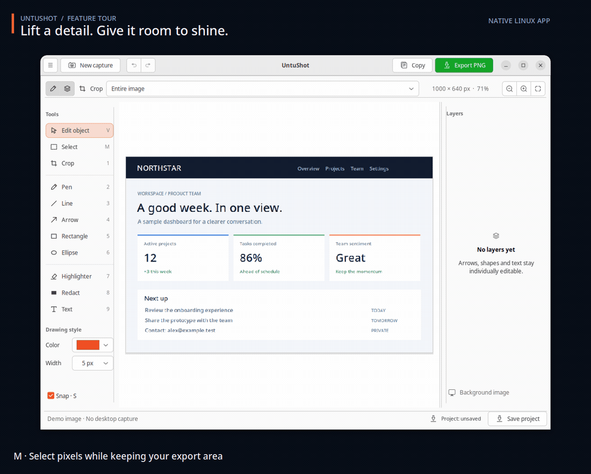

**Select → lift → resize → highlight. The original stays intact.**

</div>

UntuShot turns a screenshot into an explanation. Add arrows, shapes and text;
lift a small detail into a larger image layer; arrange a sequence of screenshots;
then share a PNG or save an editable project and come back later.

Every annotation is an object. Your original image, crop, text, image layers,
borders and shadows remain editable in a `.untushot` project.

## Get started

Requires **Rust 1.75+**, **GTK 3.24+** development files and `pkg-config`.
On Debian or Ubuntu:

```sh
sudo apt install build-essential pkg-config libgtk-3-dev
cargo build --release --locked
./target/release/untushot --demo
```

The demo uses synthetic images. To capture your desktop, run without `--demo`.
UntuShot uses **grim** where the compositor supports it, otherwise the
**XDG Screenshot Portal**. Install `grim` for supported compositors, or
`xdg-desktop-portal` and your desktop's matching portal backend.

For a local desktop installation:

```sh
# Optional tray support on Ubuntu/GNOME
sudo apt install libayatana-appindicator3-1 gnome-shell-extension-appindicator python3-gi

# Run as your normal user, inside your graphical session
make install
```

On GNOME, the installer also sets up **Ctrl+Shift+X**, a tray icon and login
autostart. It backs up an existing shortcut assignment for restoration on
uninstall. To install only the files, use `make install DESKTOP_INTEGRATION=off`.
See [installation and desktop integration](docs/DEVELOPMENT.md#installation-and-desktop-integration).

## The feature tour

**Open a demo to see the feature in action.** Every animation below shows real
UntuShot GTK widgets in English, using generated sample content. Capture results
and monitor layouts are synthetic; the tray clip previews the application's menu.
These recordings do not demonstrate a real portal permission dialog or validate
physical mixed-DPI capture.

### Capture and frame

<details>
<summary><strong>01 · Capture your way</strong> — region, full screen, system selection and a cancellable timer</summary>

Choose the source and an optional **0–60 second delay**. For a region capture,
select and confirm the area before the editing tools appear. Cancel a countdown
without losing the document you were working on.

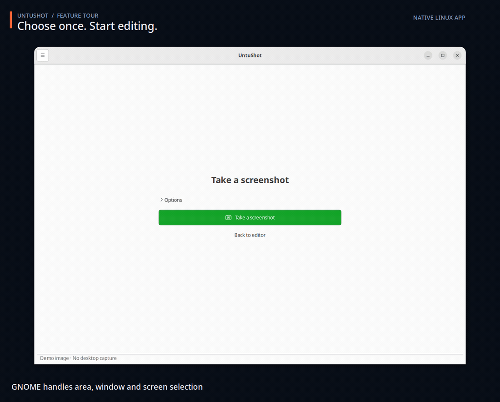

</details>

<details>
<summary><strong>02 · One canvas across monitors</strong> — monitor presets and selections across display boundaries</summary>

Inspect the visual monitor map, choose one display or draw a crop across the
combined image. Monitor guides help while editing and stay out of the export.
With a portal capture, the desktop controls the image area; exact monitor presets
are offered only when the mapping is known.

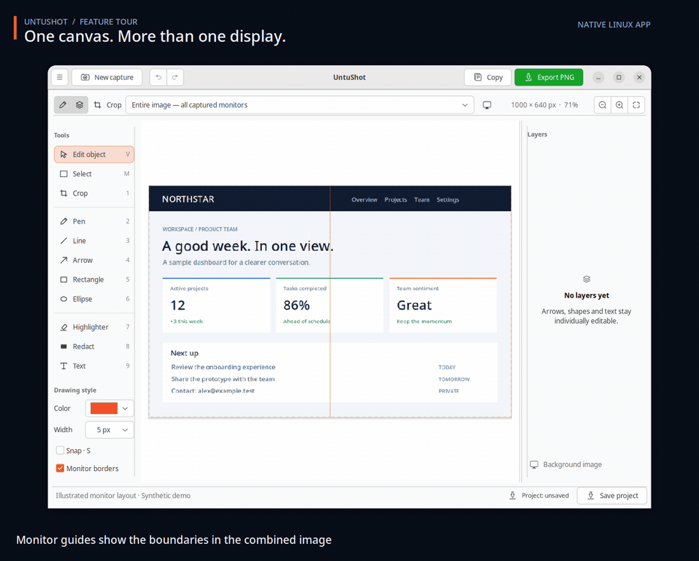

</details>

<details>
<summary><strong>03 · Crop with confidence</strong> — eight handles, keyboard nudging and undo</summary>

Draw a crop, adjust its edges or move it from the inside. Use the arrow keys for
**1 px** adjustments or Shift for **10 px**. The original remains available when
you revise the crop or undo it. Region selection also provides a pixel magnifier.

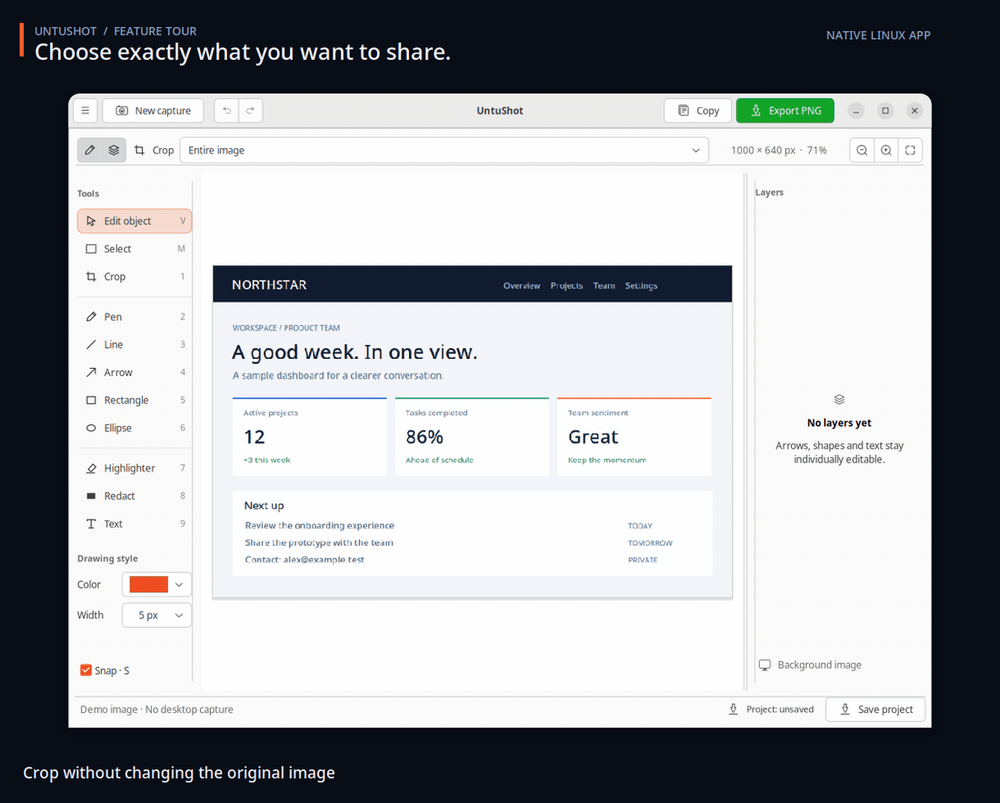

</details>

### Explain what matters

<details>
<summary><strong>04 · A complete annotation toolkit</strong> — pen, line, arrow, rectangle, ellipse, highlighter and redaction</summary>

Sketch freely, point to a result, frame a section or underline the next step.
The highlighter keeps the text beneath it readable. **Redaction writes fully
opaque pixels into the exported image.** Each mark remains a separate layer in
the editable project, which also retains the original image.


</details>

<details>
<summary><strong>05 · Text that stays editable</strong> — in-place editing, size previews and local undo</summary>

Double-click text to edit it on the canvas. Enter applies; Shift+Enter adds a line;
Escape discards the session. The font picker previews common sizes with **Sample**;
custom sizes range from **6–512 image pixels**.

Undo and redo individual typing, deletion, paste and style changes while keeping
the cursor and selection. Applying the finished session creates **one document
undo step**.

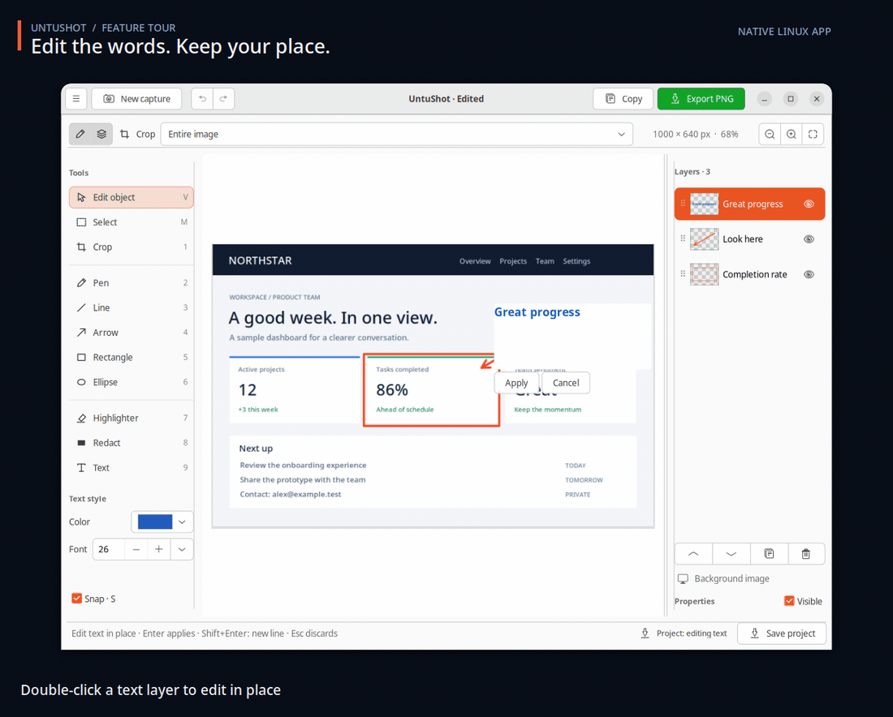

</details>

<details>
<summary><strong>06 · Style controls where you need them</strong> — anchored color palettes and stroke previews</summary>

Choose colors beside the tool, not in a detached dialog. Stroke presets show
consistent **1:2 thickness previews**; enter any exact width from **1–100 px**.
Text size is independent of line width. Changes to selected objects are reversible.

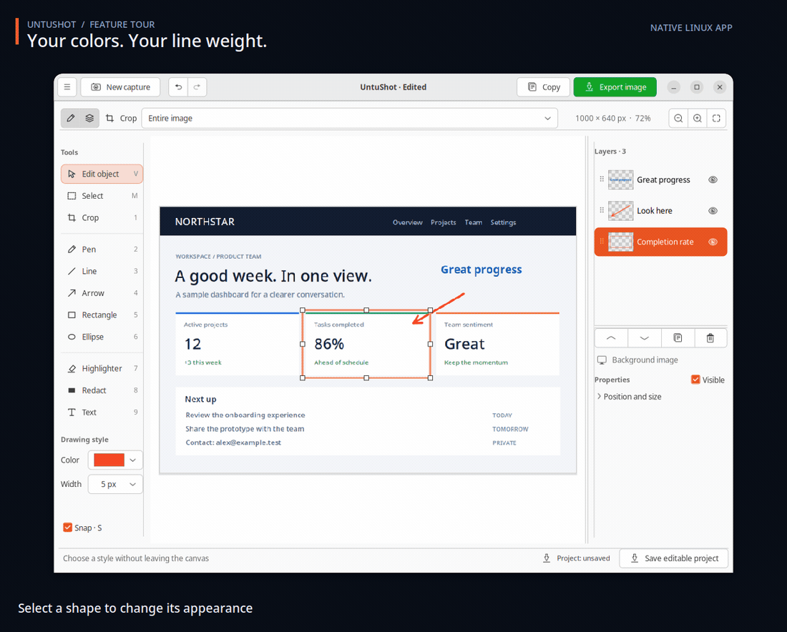

</details>

### Bring the details forward

<details>
<summary><strong>07 · Turn a selection into a new layer</strong> — copy, paste, enlarge and reposition</summary>

Use **M** to select visible pixels, then **Ctrl+J** to lift them into a new image
layer. Or copy with Ctrl+C and paste with Ctrl+V. The selection includes visible
annotations; the original layers remain intact. Images copied from other apps can
also be pasted directly as layers.


</details>

<details>
<summary><strong>08 · Borders and shadows</strong> — live, adjustable effects for image layers</summary>

Set border color and width, then tune shadow opacity, blur and offset. Changes
appear immediately. Image layers preserve their proportions when resized, and
all effects are retained in the project and rendered in PNG and clipboard output.

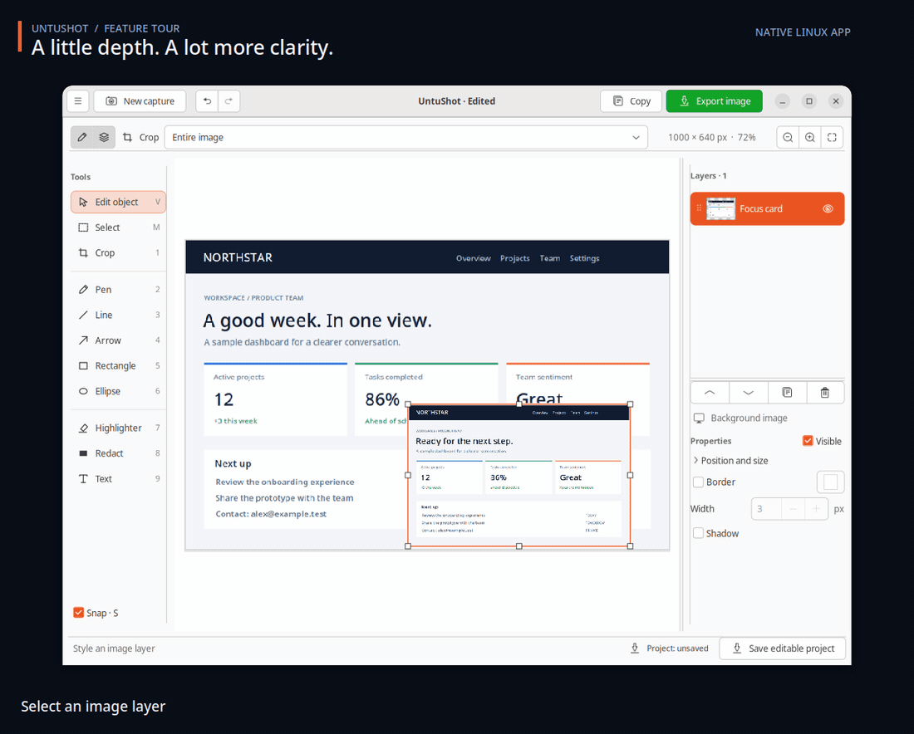

</details>

<details>
<summary><strong>09 · Pixel-precise geometry</strong> — X, Y, width, height and eight resize handles</summary>

Open **Position and size** to enter exact values with live preview. Images and
text keep their aspect ratio. A continuous edit to one property forms one undo
step; invalid values leave the last valid result intact.

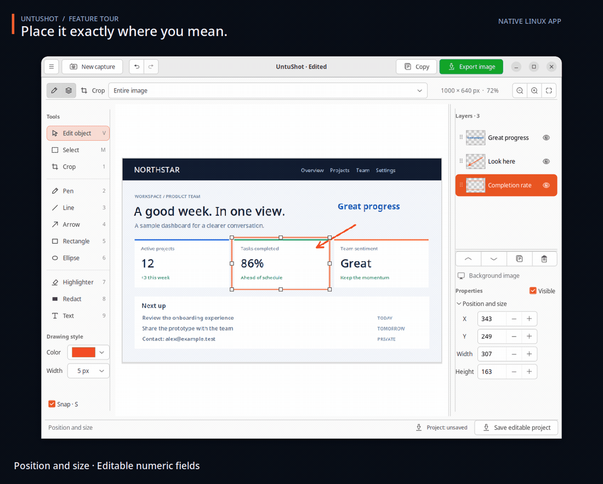

</details>

<details>
<summary><strong>10 · Snapping and alignment guides</strong> — edges, centers and a temporary free-move override</summary>

Press **S** to toggle snapping to visible objects and the image area. Hold **Alt**
while dragging to move freely. Guides appear only during the move and never become
part of the exported image.

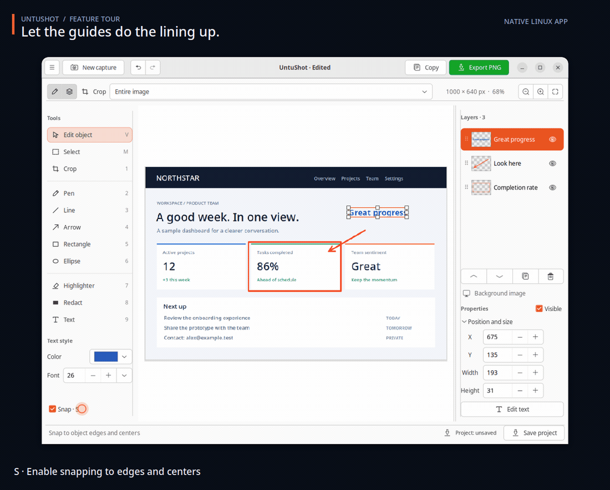

</details>

### Stay in control of every layer

<details>
<summary><strong>11 · A proper layer stack</strong> — selection, inline renaming, drag reordering and visibility</summary>

Click to select one layer, Ctrl-click to toggle additional layers, or Shift-click
to select a range. Double-click a name or press **F2** to rename it in place.
Drag a row to reorder it: insertion guides show the target, and the list scrolls
near its edges. The eye icon hides a layer without deleting it.

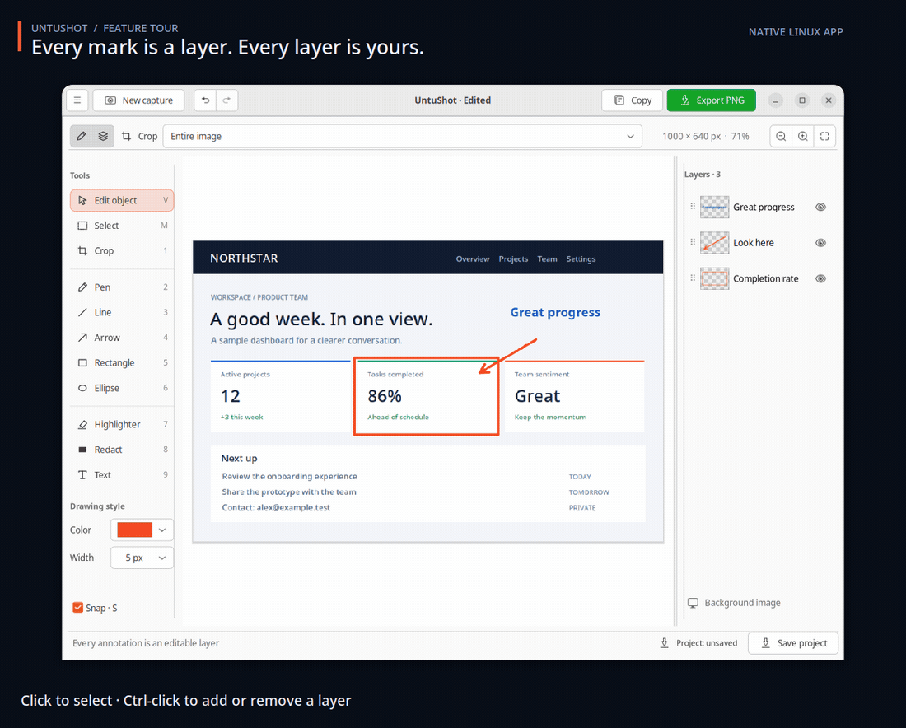

</details>

<details>
<summary><strong>12 · Work with groups</strong> — multi-selection, duplication, alignment and deletion</summary>

Move selected objects together, duplicate the group with **Ctrl+D**, and align
its edges or centers. Group deletion and duplication are single undo steps.

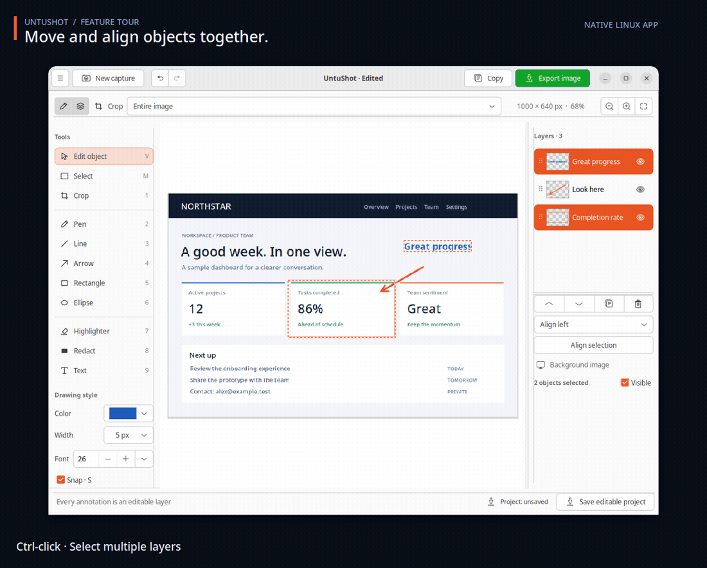

</details>

<details>
<summary><strong>13 · Object actions at your pointer</strong> — a focused right-click menu</summary>

Right-click an object to duplicate it, move it forward or backward, delete it or
edit its text. Right-clicking a selected group member preserves the multi-selection.

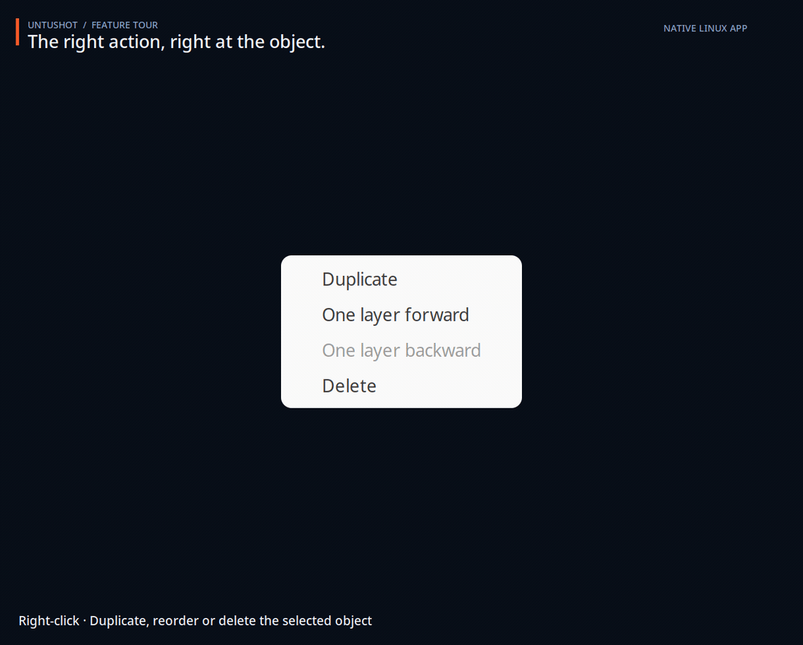

</details>

<details>
<summary><strong>14 · A workspace that makes room</strong> — zoom, pan, collapsible panels and a resizable inspector</summary>

Zoom around the pointer with **Ctrl+wheel**, pan with **Space+drag** or the middle
mouse button, and press **0** to fit the image. F8/F9 toggle the tool and layer
panels; Tab toggles both. Resize the layer sidebar by dragging its divider.
Layer properties keep the height they need; the list above scrolls independently.

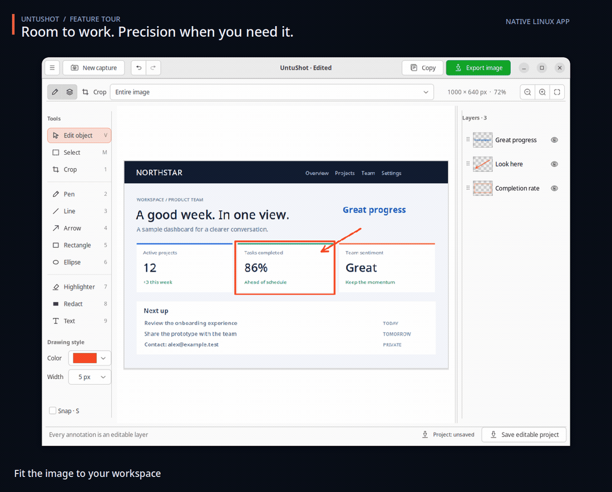

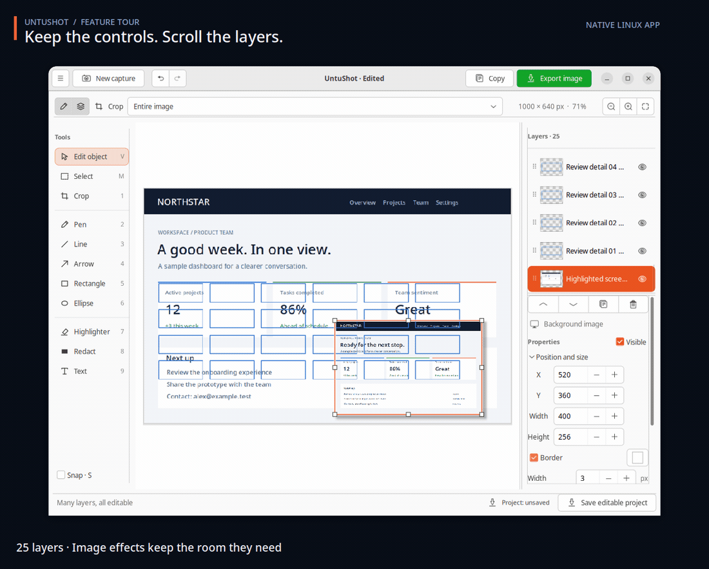

</details>

### Share the result. Keep the work.

<details>
<summary><strong>15 · Editable projects</strong> — save and reopen the original, crop and every layer</summary>

**Save project** writes a `.untushot` file with embedded image layers. Reopen it to
continue editing each object, including text, borders and shadows. The original
source files do not need to remain in place. Older `.rustshot` projects are still
readable.

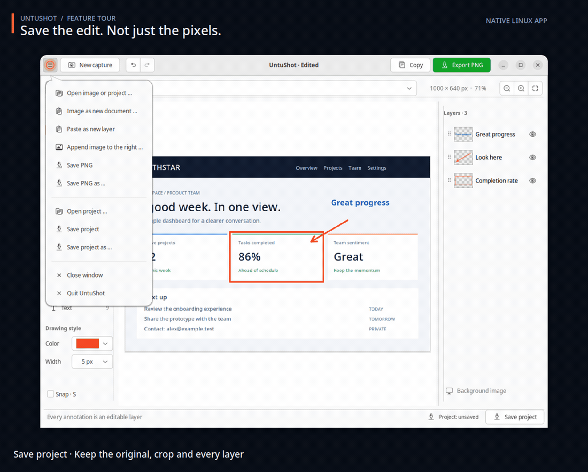

</details>

<details>
<summary><strong>16 · PNG and clipboard output</strong> — clear destinations and separate save states</summary>

Copy the rendered image or export a PNG. Open text and numeric edits are applied
first. **Image export, editable project and autosave have independent status
indicators**, so you can tell exactly what is saved. Opening an image never
silently makes its original path an overwrite target.

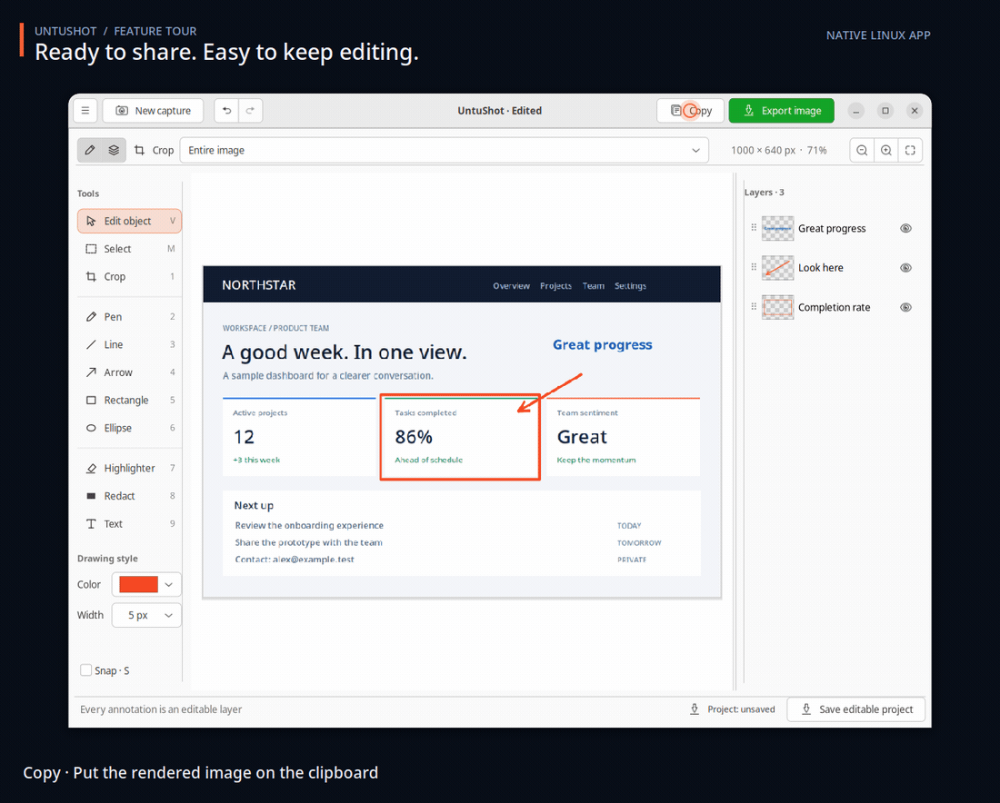

Keep UntuShot running until you paste, unless a clipboard manager retains the
image. Hiding the window to the tray is fine.

</details>

<details>
<summary><strong>17 · Session recovery</strong> — automatic background saving with confirmed status</summary>

Recovery files preserve the original image and editable state. “Automatically
saved” appears only after the write succeeds. An unlocked saved session can be restored
on the next start; active sessions are protected by locks. Save a project when
you want a durable, named file of your own.

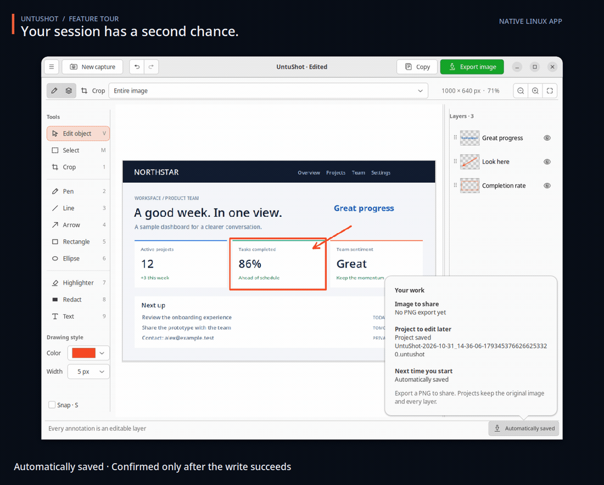

</details>

### Keep the workflow moving

<details>
<summary><strong>18 · Recent screenshots</strong> — a collapsible history below the canvas</summary>

Browse up to **60 recently modified PNG/JPEG images** in your screenshot folder.
Previews load in the background. Opening a capture preserves the original; the
history retains your scroll position as files are added or refreshed.

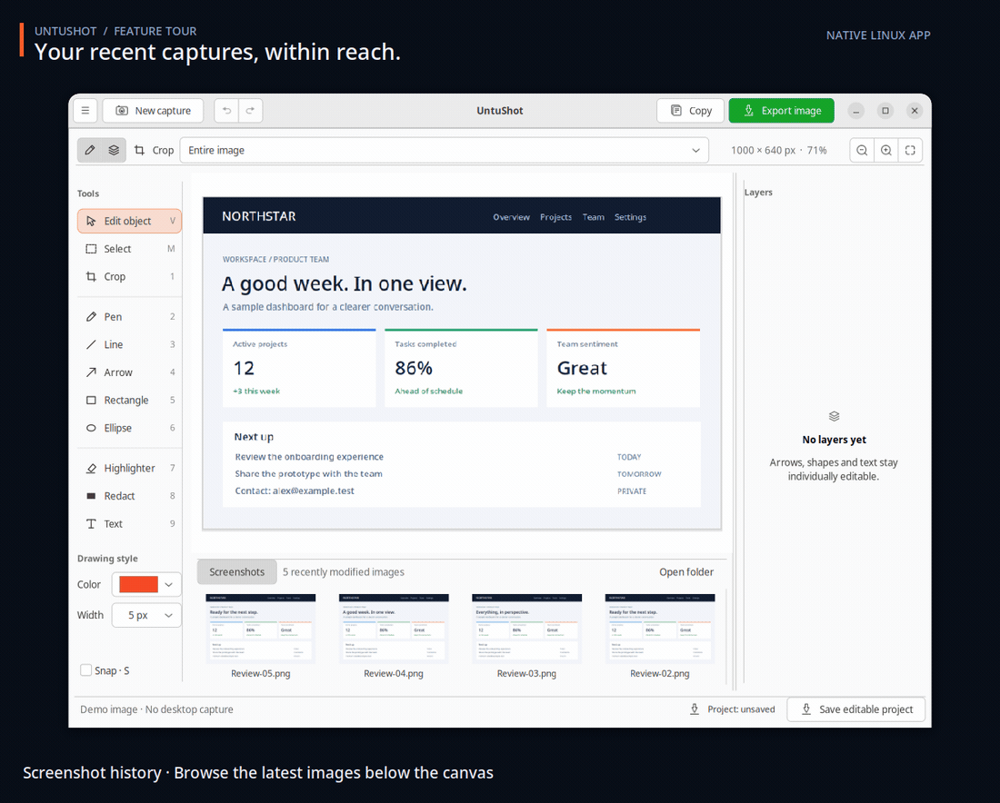

</details>

<details>
<summary><strong>19 · Multi-image walkthroughs</strong> — compose a flow from several screenshots</summary>

Use **Ctrl+I** or the history context menu to append an image on the right.
The canvas grows with a transparent gap; the original and appended images become
editable layers. Existing annotations remain separate. Undo reverses the append
and the canvas expansion together.

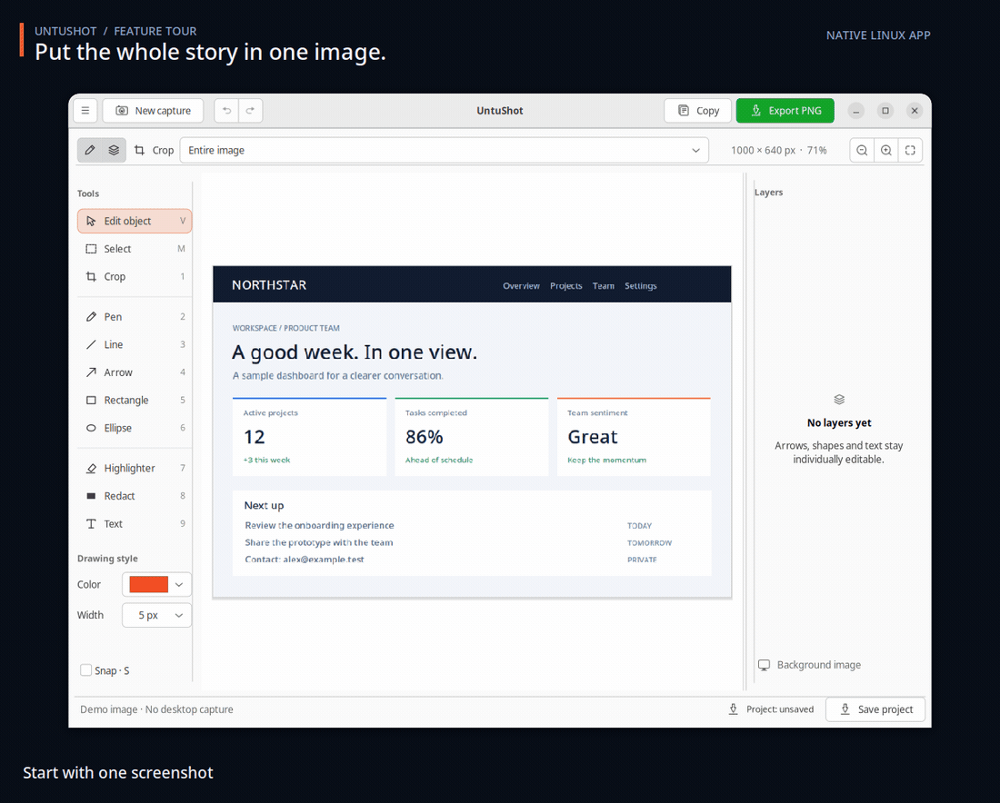

</details>

<details>
<summary><strong>20 · Full-page image import</strong> — a scrollable preview for long browser screenshots</summary>

Capture and copy the page in your existing browser session, then use **Import
web page**. Check the preview at fit-to-width or 100%, scroll to the bottom and
open the full-resolution image in the editor. UntuShot imports the image;
it does not automatically control or scroll your browser tab.

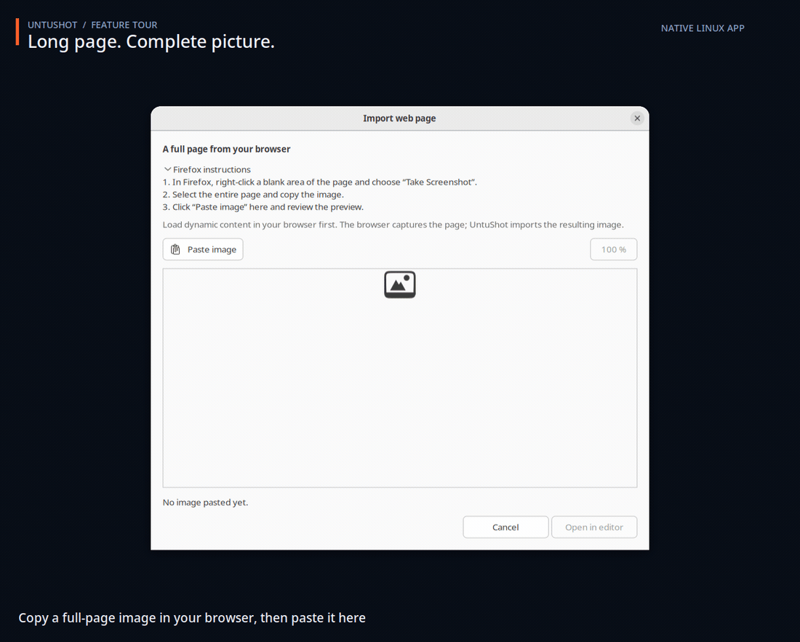

</details>

<details>
<summary><strong>21 · Native appearance and four languages</strong> — your desktop's theme, accent and language</summary>

GTK controls follow the desktop appearance, including light/dark themes and
supported accent colors. The interface automatically chooses **English, German,
French or Spanish**, with English as the fallback.

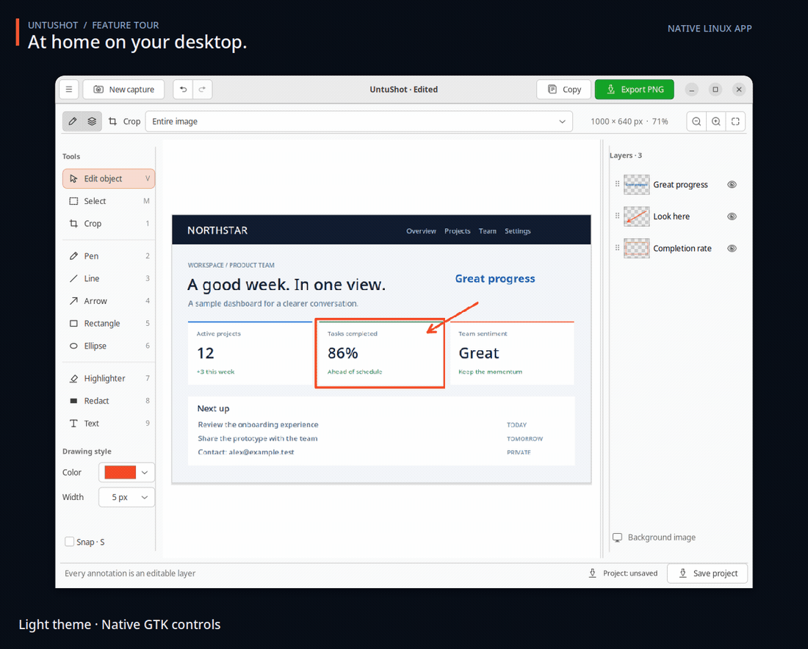

</details>

<details>
<summary><strong>22 · Ready in the tray</strong> — quick capture, delayed capture and desktop shortcuts</summary>

Start a capture from the tray without opening the editor first. The application
menu offers region, delayed region and full-screen capture, system selection,
opening the editor, cancelling a capture and quitting. On supported GNOME setups,
installation adds **Ctrl+Shift+X**, login autostart and **Open with** for PNG/JPEG.

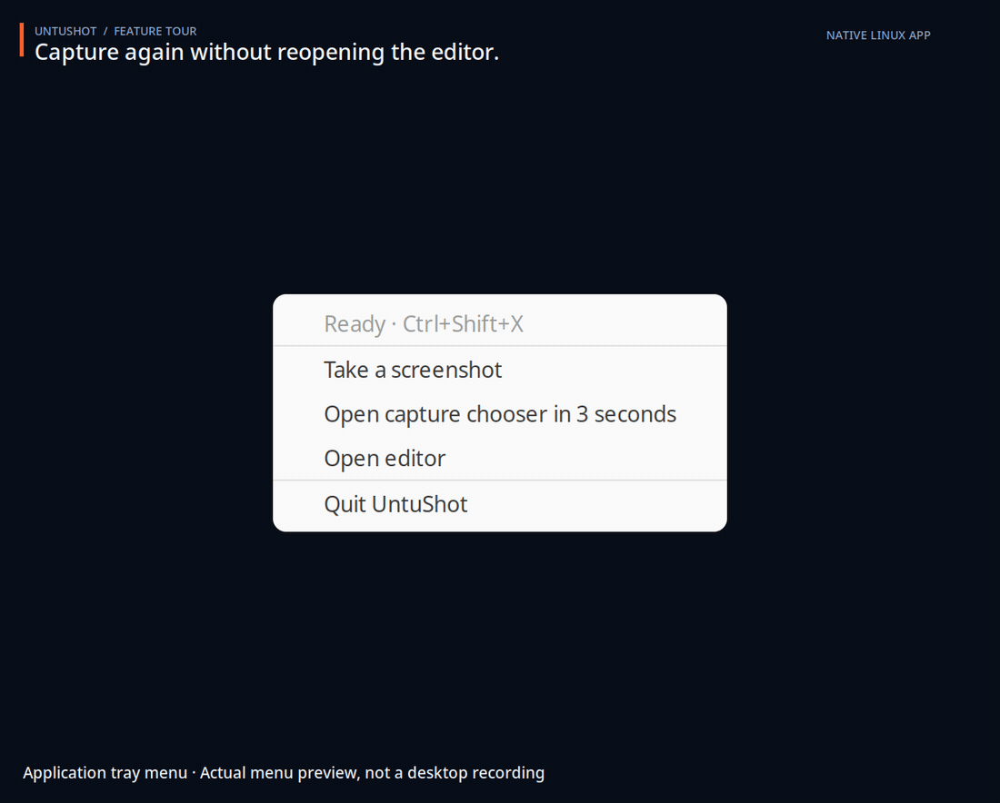

The clip shows the application menu on an isolated display. Tray availability,
portal permissions and global shortcuts depend on the desktop environment.

</details>

## Your desktop, your language

| Interface language | Recognized locale examples |
| --- | --- |
| English | `en_US`, `en_GB` |
| Deutsch | `de_DE`, `de_AT`, `de_CH` |
| Français | `fr_FR`, `fr_CA` |
| Español | `es_ES`, `es_MX` |

UntuShot checks `LANGUAGE` (including preference lists), then `LC_ALL`,
`LC_MESSAGES` and `LANG`. Regional variants select the matching language;
unsupported locales fall back to English. Translations are embedded in the binary.
Your text, layer names and file paths are never translated.

To try a language in a separate demo window:

```sh
LANGUAGE=en untushot --demo
LANGUAGE=de untushot --demo
LANGUAGE=fr untushot --demo
LANGUAGE=es untushot --demo
```

The running background instance keeps the language it started with. Fully quit
UntuShot, including the tray, and restart it after changing your system language.
This README and all feature-tour GIFs use English.

## Keyboard shortcuts

| Action | Shortcut |
| --- | --- |
| Capture from the desktop¹ / new capture in the editor | `Ctrl+Shift+X` / `Ctrl+N` |
| Move objects / select pixels / crop | `V` / `M` / `1` |
| Pen / line / arrow / rectangle / ellipse / highlighter / redact / text | `2` through `9` |
| Copy pixels to a new layer / paste an image layer | `Ctrl+J` / `Ctrl+V` |
| Import clipboard image with preview / append image on the right | `Ctrl+Shift+V` / `Ctrl+I` |
| Duplicate / rename / delete | `Ctrl+D` / `F2` / `Delete` |
| Undo / redo | `Ctrl+Z` / `Ctrl+Shift+Z` or `Ctrl+Y` |
| Nudge / larger nudge | Arrow keys / `Shift` + arrow keys |
| Zoom / pan / fit image | `Ctrl` + wheel / `Space` + drag / `0` |
| Snap / temporarily bypass snapping | `S` / hold `Alt` |
| Toggle tools / layers / both panels | `F8` / `F9` / `Tab` |
| Open image or project | `Ctrl+O` |
| Export PNG / export PNG as | `Ctrl+S` / `Ctrl+Shift+S` |
| Save project / save project as | `Ctrl+Alt+S` / `Ctrl+Alt+Shift+S` |
| Apply / cancel the current edit | `Enter` / `Esc` |
| Fullscreen / close window / quit completely | `F11` / `Ctrl+W` / `Ctrl+Q` |

¹ Set up by the supported desktop integration; other desktops can bind the same
command manually. Closing the window keeps the app in the background when its
tray integration is active.

## A few useful commands

```sh
untushot --capture region --delay 3   # Prepare, capture, select, annotate
untushot --capture full              # Capture the full source
untushot --capture system            # Use the desktop portal's selection
untushot --backend grim              # Direct capture on supported compositors
untushot --backend portal            # Use the desktop portal
untushot --list-monitors             # Inspect monitor IDs and geometry
untushot --open image.png            # Edit an existing image
untushot --background                # Start in the tray
untushot --status                    # Query the background instance
untushot --quit                      # Save the session and quit
```

## Built to keep your work editable

- **100 document undo steps**, with a separate history while editing text.
- **Original image retained**; PNG and clipboard render the finished composition.
- **Atomic saves** for projects and recovery files.
- **Shared rendering** for preview and export, with bounded preview caches.
- **No browser runtime**: Rust, GTK 3 and Cairo handle the editor.

Automated checks cover text editing, layers, projects, clipboard transport,
recovery, rendering, locale selection and a 30-layer session with 140 document
changes followed by 100 undo and 100 redo steps. Real mixed-DPI monitor and
hotplug acceptance remains a separate hardware check.

Automatic browser-tab capture, timed capture sequences and GTK4 migration remain
future work. See the [development guide](docs/DEVELOPMENT.md) for tests, architecture,
limits and how to regenerate the GIFs. The previous detailed German notes are
preserved in the [technical reference](docs/handbook-de.md).

---

**MIT licensed.** See [LICENSE](LICENSE). Inspired by the screenshot-and-annotate
workflow popularized by Flameshot; an independent implementation.
